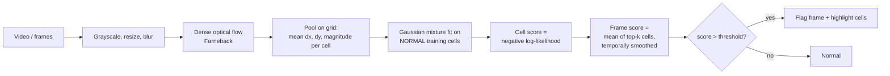

# Crowd Anomaly Detection

**Flag unusual events in pedestrian-scene surveillance video by learning what "normal" motion looks like.**

[](https://github.com/sanjeebtiwary/Crowd-Anomaly-Detection)


---

## Contents

[Overview](#overview) · [How it works](#how-it-works) · [Quick start](#quick-start) · [Dataset](#dataset) · [Usage](#usage) · [Configuration](#configuration) · [Project structure](#project-structure) · [Testing](#testing) · [What changed](#what-changed-from-the-original-notebook) · [Limitations](#limitations) · [Roadmap](#roadmap) · [References](#references) · [License](#license)

## Overview

Abnormal events in crowds can't be enumerated in advance, so this project uses a **one-class** approach: fit a model on *normal-only* footage, then score how far new observations deviate from it. In the UCSD data, anomalies include **bikers, skaters, carts and wheelchairs** on a pedestrian walkway, and unusual pedestrian motion.

It provides:

- **one-step dataset download** from Kaggle with `kagglehub` (no manual download or folder setup)
- a reusable Python package (`crowd_anomaly/`) and a command line (`download`, `train`, `evaluate`, `predict`)
- frame-level evaluation (ROC-AUC, EER, precision/recall) with plots
- anomaly **localization overlays**: annotated output video highlights the cells that look unusual
- models that accept **any video** (`.avi`, `.mp4`, ...) or folder of frames, resized automatically
- a test suite (runs offline on generated data)

> **Results.** No UCSD accuracy figures are published here yet. Run `train --evaluate` on your copy of the data and report your own numbers (see [Roadmap](#roadmap)).

## How it works



1. **Features.** For each pair of consecutive frames, dense Farneback optical flow is pooled on a `6 x 8` grid. Each cell keeps `[mean dx, mean dy, mean magnitude]` (`basic`), or additionally the cell's max magnitude and magnitude std (`rich`), which stops a small fast object from being averaged away by its mostly static cell.
2. **Normality model.** Every cell of every training frame is a sample `[dx, dy, magnitude, y, x]`. Position is included because motion near the camera looks different from motion far away (perspective). A `StandardScaler` and a `GaussianMixture` are fitted on these samples.
3. **Scoring.** A cell's anomaly score is its negative log-likelihood (higher = more unusual). The frame score is the mean of the `top_k` highest cell scores, then smoothed over time, so a single moving object is not drowned out by a mostly static scene.
4. **Thresholding.** Whole training clips are held out (never individual frames) and the threshold is the 99th percentile of their scores, i.e. it targets roughly a 1% false-alarm rate on normal footage.

> **Naming.** The original notebook called this "MDT". The papers' Mixture of Dynamic Textures is a mixture of linear dynamical systems over appearance and dynamics. This project implements a simpler **optical-flow + Gaussian mixture** model that follows the same "learn normal, score deviation" principle but is *not* a reimplementation of the papers' MDT.

## Quick start

```bash
git clone https://github.com/sanjeebtiwary/Crowd-Anomaly-Detection.git
cd Crowd-Anomaly-Detection

python -m venv .venv
source .venv/bin/activate            # Windows: .venv\Scripts\Activate.ps1
pip install -r requirements.txt

# Downloads the dataset from Kaggle automatically, trains, and evaluates
python -m crowd_anomaly train --subset ped1 --model-out models/ped1.joblib --evaluate
```

No dataset setup is needed: when `--data-root` is omitted, the dataset is fetched with `kagglehub` and cached locally, so later runs reuse it.

## Project structure

```text
Crowd-Anomaly-Detection/
├── backend/
│   └── app/                 # FastAPI routes, request/response schemas, model service
├── src/
│   └── crowd_anomaly/       # Reusable ML package and CLI
├── artifacts/               # Trained model artifact(s) required for inference
├── assets/                   # README diagrams and images
├── tests/                    # Automated pipeline tests
├── reports/                  # Evaluation reports (generated/optional)
├── model.ipynb               # Research/experimentation notebook
├── pyproject.toml            # Package and dependency configuration
├── Dockerfile                # Container deployment for API
└── requirements-api.txt      # API installation shortcut
```

## Backend API (FastAPI)

The backend is separate from the model code. It loads `artifacts/ped1.joblib` once and exposes a video-upload endpoint. It does not require a local frontend.

### Run locally

```bash
python -m venv .venv
# Windows PowerShell: .\.venv\Scripts\Activate.ps1
# macOS/Linux: source .venv/bin/activate
pip install -r requirements-api.txt
uvicorn backend.app.main:app --reload --host 0.0.0.0 --port 8000
```

Open `http://127.0.0.1:8000/docs` to try `POST /predict`. Upload an MP4/AVI/MOV/MKV video. `GET /health` checks whether the trained model loaded. Configure `MODEL_PATH` if the model artifact is stored elsewhere, `CORS_ORIGINS` as a comma-separated list of frontend origins, and `MAX_UPLOAD_MB` to change the upload limit.

### Deploy with Docker

```bash
docker build -t crowd-anomaly-api .
docker run --rm -p 8000:8000 crowd-anomaly-api
```

For a cloud host that supports Docker, deploy this repository using the included `Dockerfile`. The API needs the model artifact in the image or mounted at `MODEL_PATH`. Free hosting tiers and video-processing limits can change; large uploads or long videos may exceed a provider's CPU, memory, request-timeout, or storage limits. This API processes videos synchronously and keeps uploads only in temporary storage.

### API response

`POST /predict` returns `frames_processed`, `threshold`, per-frame `scores` and `flags`, `anomaly_frames`, `anomaly_detected`, and inclusive frame-index `segments`. This initial API returns scores as JSON; it does not persist uploaded videos or generate annotated videos.

## Dataset

**[UCSD Anomaly Dataset on Kaggle](https://www.kaggle.com/datasets/orvile/ucsd-anomaly-dataset/data)** - a stationary, elevated camera over pedestrian walkways. Training clips are normal; test clips contain anomalies.

| Subset | Scene | Train clips | Test clips | Frame size |
|---|---|---:|---:|---|
| **Ped1** | People walking toward/away from the camera (perspective distortion) | 34 | 36 | 238 x 158 |
| **Ped2** | Movement parallel to the camera plane | 16 | 12 | 360 x 240 |

Clips are ~200 frames of `.tif` images. Ground truth: a frame-level flag for every test clip (a `.m` file) and pixel masks (`TestXXX_gt/`) for a subset.

### Automatic download

The code downloads the data exactly like this (it is what `train` and `evaluate` do when `--data-root` is omitted):

```python
import kagglehub

# Download latest version
path = kagglehub.dataset_download("orvile/ucsd-anomaly-dataset")

print("Path to dataset files:", path)
```

or from the command line: `python -m crowd_anomaly download`. Files are cached by `kagglehub` (by default under `~/.cache/kagglehub`). If Kaggle asks for credentials, set `KAGGLE_USERNAME` / `KAGGLE_KEY` or call `kagglehub.login()`.

The `ped1` / `ped2` folders (also accepted as `UCSDped1` / `UCSDped2`) are located automatically inside the downloaded files; they contain `Train/Train001...` and `Test/Test001...` clip folders.

<table>
  <tr>
    <td align="center" width="50%"><strong>Cart</strong><br></td>
    <td align="center" width="50%"><strong>Wheelchair</strong><br></td>
  </tr>
  <tr>
    <td align="center" width="50%"><strong>Skater</strong><br></td>
    <td align="center" width="50%"><strong>Biker</strong><br></td>
  </tr>
</table>

## Usage

### 1. Train (and optionally evaluate)

```bash
python -m crowd_anomaly train --subset ped1 --model-out models/ped1.joblib --evaluate --jobs -1
```

Useful options: `--components 12`, `--auto-components` (choose by BIC), `--grid 12 16`, `--feature-set rich`, `--top-k 5`, `--smooth-sigma 2`, `--val-fraction 0.2`, `--max-clips 10` (quick experiments), `--seed 0`, and `--data-root <folder>` to use an already-downloaded copy instead of Kaggle.

### 2. Evaluate

```bash
python -m crowd_anomaly evaluate --subset ped1 --model models/ped1.joblib --report-dir reports/ped1
```

Writes `metrics.json` (AUC, EER, average precision, precision/recall/F1 at the calibrated threshold, per-clip AUC), `roc.png` and `timelines.png`. AUC and EER are computed over frames pooled across all labelled test clips, the usual UCSD frame-level protocol.

### 3. Check your ground truth

Frame-level labels come from the dataset's `UCSDped1.m` file. If your download does not contain it, only the clips that have pixel masks (10 of 36 in Ped1) can be scored, and the evaluation says so:

```text
WARNING No ground truth for 26 of 36 test clips (evaluating the other 10) ...
INFO Evaluated 10 of 36 test clips: 2000 frames, 62% anomalous
```

Numbers from that subset are **not** comparable with published full-test-set results (it is anomaly-heavy, and average precision looks flattering at a 62% base rate). To score all 36 clips, point at the `.m` file from the [original UCSD release](http://www.svcl.ucsd.edu/projects/anomaly/dataset.htm) with `--gt-file path/to/UCSDped1.m`. A `.m` file found anywhere inside the download is used automatically.

### 4. Speed up experiments (feature cache) and compare settings

Optical-flow extraction is the slow part, so features are cached in `.feature_cache/` (keyed by clip contents and every feature setting). Re-running `train`, `evaluate` or `sweep` with different *model* settings reuses them. Use `--no-cache` to disable, `--cache-dir` to move it.

`sweep` tries combinations and ranks them by frame-level AUC:

```bash
python -m crowd_anomaly sweep --subset ped1 \
    --grids 6x8,12x16 --feature-sets basic,rich --components 8,16 --top-ks 1,3,5 --smooths 2
```

Results go to `reports/sweep.csv`. **Caveat:** this ranks settings on the test labels, so the best AUC is optimistic. Treat it as tuned-on-test, or hold out some labelled clips for the final number.

### 5. Predict on a video or folder of frames

```bash
python -m crowd_anomaly predict --source test.avi --model models/ped1.joblib --out outputs/
# or the original entry point, which defaults to test.avi + models/model.joblib:
python load_predict.py
```

Outputs: `scores.csv` (`frame, score, threshold, is_anomaly`), `scores.png` (score timeline with flagged segments shaded), and `annotated.mp4` (red border and label on flagged frames, red tint on unusual cells). The console lists anomalous frame ranges; segments shorter than `--min-segment` frames (default 3) are not reported.

### 6. Use it from Python

```python
from crowd_anomaly import Config, CrowdAnomalyModel
from crowd_anomaly.data import discover_clips, find_subset_dir
from crowd_anomaly.download import download_dataset
from crowd_anomaly.features import extract_many, clip_features

sub = find_subset_dir(download_dataset(), "ped1")
feats, size = extract_many(discover_clips(sub, "Train"), Config(), n_jobs=-1)
model = CrowdAnomalyModel(Config(n_components=8)).fit(feats, size)
model.save("models/ped1.joblib")

pred = CrowdAnomalyModel.load("models/ped1.joblib").predict(
    clip_features("test.avi", model.cfg, model.frame_size))
pred["scores"], pred["flags"], pred["cell_scores"]
```

The notebook `model.ipynb` walks through the same steps interactively, starting with the Kaggle download.

## Configuration

Everything lives in one `Config` dataclass, saved inside the model file so inference always uses the training settings.

| Setting | Default | Effect |
|---|---|---|
| `grid_rows`, `grid_cols` | 6, 8 | Spatial pooling resolution; finer grids localize better but are noisier |
| `feature_set` | `basic` | `rich` adds per-cell max magnitude and std |
| `n_components` / `auto_components` | 8 / off | Mixture size, fixed or chosen by BIC from `component_candidates` |
| `covariance_type`, `reg_covar` | `full`, 1e-4 | GMM covariance structure and regularisation |
| `top_k` | 3 | Number of worst cells averaged into the frame score |
| `smooth_sigma` | 2.0 | Temporal Gaussian smoothing of the frame score (0 = off) |
| `val_fraction` | 0.2 | Share of training *clips* held out for thresholds |
| `threshold_percentile` | 99.0 | Higher = fewer false alarms, lower recall |
| `frame_size` | auto | Working resolution `(w, h)`; inferred from the first training frame |
| `blur_ksize`, `flow_*` | 3, Farneback defaults | Preprocessing and optical-flow parameters |
| `seed` | 0 | Reproducibility |

## Project structure

```text
Crowd-Anomaly-Detection/
├── crowd_anomaly/
│   ├── config.py        # Config dataclass + validation
│   ├── download.py      # kagglehub download of the UCSD dataset
│   ├── data.py          # dataset discovery, frame/video reading, ground-truth parsing
│   ├── features.py      # optical flow + grid pooling, parallel extraction
│   ├── model.py         # CrowdAnomalyModel: fit / score / threshold / save / load
│   ├── evaluate.py      # AUC, EER, precision/recall, plots
│   ├── inference.py     # predict on video/folder; CSV, plot, annotated video
│   └── cli.py           # python -m crowd_anomaly {download,train,evaluate,predict}
├── tests/               # test_pipeline.py + synthetic.py (offline test data)
├── load_predict.py      # backward-compatible entry point
├── model.ipynb          # interactive walk-through
├── requirements.txt / requirements-dev.txt
└── README.md
```

## Testing

```bash
pip install -r requirements-dev.txt
python -m pytest -q
```

The 23 tests run offline on generated data and cover dataset discovery (including Kaggle-style nested folders), ground-truth parsing and fallbacks (`.m` ranges, pixel masks, `--gt-file`), feature shapes and the rich features, the feature cache, model save/load, end-to-end detection, the `kagglehub` download path (stubbed), the `sweep` command, video input at a different resolution, and CLI error handling. They verify the code works, not how accurate it is on real footage.

## What changed from the original notebook

| Original | Now |
|---|---|
| `mdt_model.save('model.h5')` crashed (scikit-learn GMM has no `.save()`) | `joblib` persistence with version check, config, thresholds and frame size stored |
| Hard-coded `D:\...` paths; 35 directories typed by hand (`Train020` twice) | Automatic `kagglehub` download and folder discovery |
| Frames from all clips concatenated, so flow was computed across clip boundaries | Features computed per clip |
| `extract_features` defined twice; first version collapsed flow to 2 numbers | One grid-pooled feature (dx, dy, magnitude per cell) |
| Flattened full-resolution flow (~75k dims) fed to a GMM | 144 numbers per frame pair, modelled per cell (5-D) |
| No threshold, no evaluation | Held-out-clip threshold; AUC, EER, precision/recall, plots |
| Frame-level only, no localization | Cell scores drive an overlay on unusual regions |
| Notebook only | Package, CLI, tests |
| `random` state not fixed | Seeded and reproducible |

## Limitations

- The model is **scene-specific**: a new camera, angle or lighting generally needs retraining.
- This is a deliberately simple baseline. On Ped1 (small pedestrians, strong perspective) simple flow statistics are weak; expect modest frame-level AUC and tune grid, `rich` features and `top_k` with `sweep`. Published MDT results are a more realistic target for a full implementation.
- A coarse optical-flow grid can miss small, slow or non-moving anomalies (e.g. a stationary abandoned object).
- Localization is cell-level (default 6 x 8), not pixel-accurate, and is not yet evaluated against the pixel masks.
- A high score means "unusual compared with training", not "dangerous". Keep a human in the loop and consider privacy and retention rules for any real deployment.
- Real-time throughput was not benchmarked. The code was tested on Python 3.12 with generated data; run `train --evaluate` on the real dataset to see actual accuracy.
- `joblib` files are pickles: only load models you trained or trust.

## Roadmap

- [ ] Publish a results table for Ped1 and Ped2 (AUC / EER) on the full labelled test set
- [ ] Pixel-level localization evaluation against the `*_gt` masks
- [ ] True Mixture of Dynamic Textures baseline for comparison
- [ ] Richer features (flow histograms, temporal stacking of neighbouring frames)
- [ ] Streaming/real-time mode with a causal (non-smoothed) score

## References

1. V. Mahadevan, W. Li, V. Bhalodia, N. Vasconcelos. "Anomaly Detection in Crowded Scenes." *IEEE CVPR*, 2010. [PDF](http://www.svcl.ucsd.edu/publications/conference/2010/cvpr2010/cvpr_anomaly_2010.pdf)
2. W. Li, V. Mahadevan, N. Vasconcelos. "Anomaly Detection and Localization in Crowded Scenes." *IEEE TPAMI*, 36(1):18-32, 2014. [PDF](http://www.svcl.ucsd.edu/publications/journal/2013/pami.anomaly/pami_anomaly.pdf)
3. Dataset: [UCSD Anomaly Dataset on Kaggle](https://www.kaggle.com/datasets/orvile/ucsd-anomaly-dataset/data) (original data from the UCSD Statistical Visual Computing Lab).

## Contributing

Fork, create a feature branch, make a focused change with tests (`python -m pytest`), and open a pull request describing the change and how you validated it.

## License

No license was specified in the supplied materials. Check the repository for a `LICENSE` file before reuse, and consider adding one (e.g. MIT or Apache-2.0). The UCSD dataset has its own terms of use.
